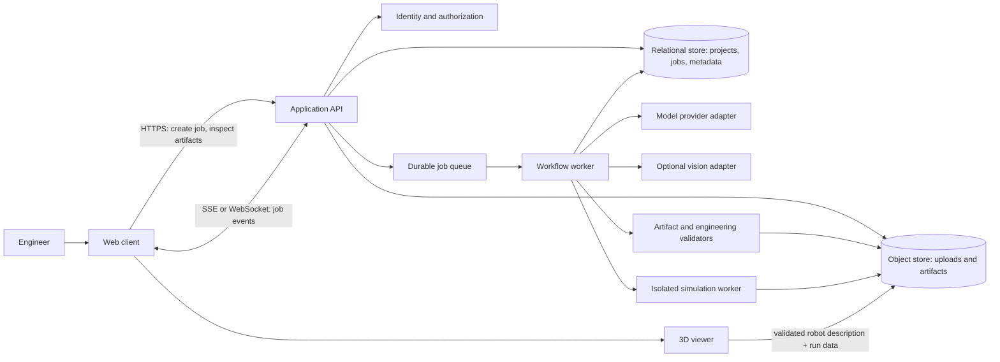

# ForgeBot System Architecture

> **Status:** proposed target architecture, derived from the project brief in `forge bot docs.rtf`. It is not a description of verified, implemented behavior. Update the implementation status after inspecting the source repository.

## 1. Product goal

ForgeBot helps an engineer turn a robotics mission brief into a reviewable, simulation-ready prototype package. It can propose a design, generate robot description and control artifacts, run automated checks, and present the results in an interactive viewer. It must communicate assumptions and failed checks clearly. A successful software simulation is evidence for further engineering review; it is not proof that a physical robot is safe or buildable.

## 2. Architecture principles

- Keep the browser, orchestration service, model providers, and simulation runtime behind explicit interfaces.
- Treat model output, uploaded files, and generated code as untrusted input.
- Use versioned, typed artifacts as the hand-off between workflow stages; do not pass free-form model prose as the system's source of truth.
- Make long-running jobs durable, observable, cancellable, and safe to retry.
- Run parsing, simulation, and generated-code checks with resource limits and isolation.
- Distinguish deterministic validation results from model suggestions and simulation approximations.
- Store enough provenance to reproduce a result: input revision, model/provider and settings, artifact versions, validator versions, and run status.

## 3. Logical components

The diagram is technology-neutral. Select concrete frameworks and infrastructure after reviewing repository constraints, deployment targets, and team experience. Do not describe both FastAPI and Django as the chosen backend: choose one application framework, or document a specific reason for a split.

### Web client

The React client manages project setup, mission input, uploads, job progress, review of assumptions and artifacts, and the interactive robot viewer. It should render generated artifacts returned by the API and should not embed model-provider credentials. Model and job status must be accessible in a non-streaming fallback when a live connection drops.

### Application API

The API authenticates users, authorizes project access, validates requests, creates jobs, exposes job and artifact metadata, and streams status updates. It should not run unbounded model calls or physics simulation inside request handlers. Keep upload size/type checks, rate limits, and per-user/project quotas at this boundary.

### Workflow worker

The worker owns the durable job state machine and coordinates steps. Suggested states are `queued`, `specifying`, `awaiting_review`, `generating`, `validating`, `simulating`, `succeeded`, `failed`, and `cancelled`. Persist each transition and its timestamps. Retry transient provider or infrastructure failures with bounded backoff and idempotency keys; do not retry invalid artifacts indefinitely. Support cancellation and partial results.

### Model and vision adapters

Use provider-neutral interfaces for text reasoning, code/artifact generation, and optional image analysis. Keep provider names and capabilities in configuration and record the resolved provider/model per job. Require structured output against versioned schemas, but treat schema-valid content as untrusted until deterministic checks pass. Provider choice is an implementation decision, not an architectural dependency. Never promise flawless output.

Vision analysis may identify candidate objects, dimensions, or layout constraints from an uploaded image. Preserve confidence and source-region references where possible, and require user confirmation for measurements that materially affect safety or feasibility. Image segmentation alone does not establish engineering dimensions.

### Artifact validation

Validate each artifact before it reaches the viewer, simulator, or export package. Initial checks should include:

1. Schema validation for the design specification and BOM.
2. URDF/XML parsing, unique link/joint names, valid references, supported geometry, and a connected kinematic tree.
3. Units, positive dimensions and masses, finite inertial values, joint limits, and bounded actuator assumptions.
4. BOM completeness and traceable assumptions; flag unavailable or unverified component data rather than inventing compatibility.
5. Static checks for generated code and forbidden operations. Do not execute generated firmware in the application service.

Return machine-readable findings with severity, artifact path, and remediation guidance. A failed gate should stop downstream steps that depend on it while keeping earlier artifacts available for review.

### Simulation and 3D viewer

Separate visualization from physics. The browser viewer can parse a supported, validated robot description and render geometry and joint motion. It should not be described as a trustworthy physics engine unless its dynamics, collision handling, and numerical limits are defined and validated.

Run physics simulation in an isolated worker with CPU, memory, wall-clock, and file-system limits. Choose and document a simulation engine based on required fidelity and deployment constraints. Record engine/version, timestep, environment, initial conditions, controller, and assumptions with each result. Label results as simulated and expose warnings for unsupported dynamics, approximate materials, or missing sensor models.

### Persistence and artifacts

Use a relational database for users/projects, job state, metadata, and audit records. Store large uploads, generated files, logs, and simulation outputs in object storage. Link artifacts by immutable IDs and content hashes. Apply retention and deletion rules, and avoid placing secrets or unnecessary personal data in prompts, logs, or exported packages.

## 4. End-to-end workflow

1. **Create a project and mission.** The user enters the task, constraints, units, operating environment, payload, budget, and any safety boundaries. Validate inputs and record an immutable input revision.
2. **Analyze optional references.** Check upload limits and file types, store the original securely, then extract tentative observations. Show uncertain measurements and request confirmation where needed.
3. **Draft a design specification.** A model proposes a typed specification, kinematic topology, assumptions, and candidate BOM. Validate schema and internal consistency. Keep the job in `awaiting_review` when important assumptions need user approval.
4. **Generate artifacts.** Generate URDF and optional ROS 2 or microcontroller starter code from the approved specification. Store each artifact with its schema/version and provenance.
5. **Run deterministic checks.** Parse and validate all artifacts. Report blockers and warnings. Do not silently repair or overwrite user-approved inputs.
6. **Run simulation when supported.** Submit only validated inputs to an isolated simulation worker. Persist the configuration and results; surface unsupported features and failures as explicit outcomes.
7. **Review and export.** Let the user inspect the BOM, assumptions, validation report, simulation setup/results, and files before downloading a versioned package with a manifest and provenance. Clearly mark generated code as requiring engineering review before hardware use.

## 5. API and event contract

Define and version request, job, event, and artifact schemas. A minimal API surface may include:

- `POST /projects/{project_id}/jobs` — create a job using an idempotency key.
- `GET /jobs/{job_id}` — read current state, progress, and errors.
- `GET /jobs/{job_id}/events` — subscribe to ordered status events (SSE is sufficient unless bidirectional control is required).
- `POST /jobs/{job_id}/cancel` — request cancellation.
- `GET /artifacts/{artifact_id}` — retrieve an authorized artifact or short-lived download link.

Events should include event ID, job ID, timestamp, state, stage, and a bounded progress/detail payload. Clients must be able to resume from an event ID or fall back to polling. Never expose internal prompts, provider secrets, or unrestricted worker logs through status events.

## 6. Security, privacy, and reliability

- Authenticate users and check project-level authorization on every API and artifact request.
- Keep provider credentials server-side in a secret manager or protected environment; rotate them and redact them from logs.
- Treat prompts and uploads as potentially malicious. Use file allowlists, size limits, malware scanning where available, and isolated parsers.
- Do not execute model-generated code in the API process. Any required execution belongs in a disposable sandbox with no ambient credentials or network by default.
- Apply request/job quotas, timeouts, bounded retries, and queue backpressure.
- Make state transitions and artifact writes idempotent so worker restarts do not duplicate or corrupt results.
- Log correlation IDs, stage outcomes, validator findings, and resource usage while minimizing sensitive content.
- Back up persistent metadata and define artifact retention, recovery, and deletion behavior.

## 7. Observability and quality measures

Track job success/failure and cancellation rates, queue age, stage latency, model cost, validation failure categories, simulation resource use, and artifact export errors. Define acceptance checks for representative robot classes before claiming support. Keep model quality and deterministic validation metrics separate; a model's confidence score is not a safety certification.

## 8. Delivery plan

### Phase 1 — reliable prototype pipeline

- Choose one backend framework, one persistence strategy, and one queue/background-job approach.
- Define versioned mission, design-specification, BOM, job, and artifact schemas.
- Implement project/job APIs, durable state transitions, cancellation, and artifact storage.
- Generate one constrained robot class (for example, a differential-drive rover) and validate its URDF deterministically.
- Add a viewer for validated geometry and joints; clearly label it visualization-only.

### Phase 2 — simulation and review

- Select and integrate a physics engine in an isolated worker.
- Record simulation configuration and expose reproducible reports and failure states.
- Add user review/approval of assumptions and BOM before expensive or downstream stages.
- Add the export manifest, provenance, quotas, audit events, and operational dashboards.

### Phase 3 — broader robotics support

- Add optional sketch analysis with confidence and user confirmation.
- Expand supported robot classes, sensor models, and ROS 2 outputs behind capability checks.
- Add regression fixtures for schemas, URDF edge cases, and simulation scenarios.
- Document deployment, backup/restore, incident handling, and security review procedures.

## 9. Decisions still required

- Which backend framework and deployment target will be used?
- Which database, queue, and object store fit the expected scale and hosting environment?
- Which model providers are available, and what data may be sent to them?
- Which simulation engine and robot-description subset will be supported first?
- Which robot class is the MVP, and what measurable checks define acceptance?
- What are the authentication, retention, budget, and export requirements?

## 10. Claims to keep precise

Describe generated BOMs and code as proposals until validated against authoritative component data and tested in the target environment. Describe browser rendering as visualization. Describe physics results with their engine and assumptions. Avoid claims such as “flawless,” “instantly,” “functional,” or “ready for manufacturing” unless supported by defined tests and evidence.
