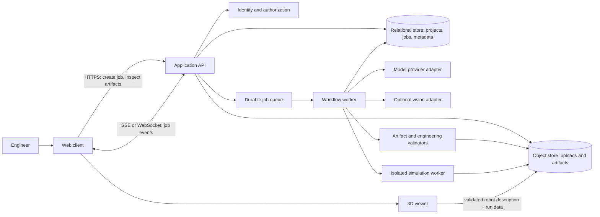

# ForgeBot System Architecture

> **Status:** partially implemented local prototype. This document separates working prototype behavior from planned production capabilities.

## 1. Product goal

ForgeBot helps an engineer turn a robotics mission brief into a reviewable, simulation-ready prototype package. It can propose a design, generate robot description and control artifacts, run automated checks, and present the results in an interactive viewer. It must communicate assumptions and failed checks clearly. A successful software simulation is evidence for further engineering review; it is not proof that a physical robot is safe or buildable.

## 2. Current implementation

- React and Three.js provide a URDF-driven tabletop-arm assembly viewer for generated box/cylinder/sphere visuals, joint transforms and limits, plus orbit and joint-pose controls. A four-axis analytic FK/IK layer maps target positions to joint poses. The kinematic preview remains distinct from the new MuJoCo arm task: Django builds a local MJCF model from the reviewed arm specification, runs contact/gravity dynamics at a fixed timestep, persists metrics and sampled joint states, and React can replay those states on the visual URDF.
- Django reads the Meta Model API key server-side from `FORGEBOT_MODEL_API_KEY`, `META_API`, or `MODEL_API_KEY`. The current local configuration uses the `META_API` alias. The provider endpoint defaults to `https://api.meta.ai/v1`, and the model defaults to `muse-spark-1.3`.
- A Meta structured-output request proposes a constrained tabletop 4-DOF arm specification and unverified BOM. The user reviews it before local code generates the URDF and starter-control scaffold.
- A second Meta-backed path proposes a constrained research humanoid. Local code creates a 31-DOF body topology, two 20-DOF hand topologies, primitive-geometry URDF, fixed sensor frames, and a reviewable joint interface. React renders the URDF in a neutral-pose orbit viewer. This is an original template inspired by public humanoid capabilities; it does not reproduce Agile ONE SN internals.
- Deterministic semantic, URDF, static-code, and arm physics acceptance checks run locally. MuJoCo checks bilateral gripper contact, a measured 30 mm payload lift, release/tabletop settling, endpoint placement, joint speed limits, and unexpected contacts for a tabletop pick/place task. The model uses force-limited gripper servos and simulated contact friction without an equality weld or ideal grasp latch; geometry and inertias remain estimates. A project benchmark repeats the same default task against up to eight recent successful tabletop-arm designs and persists a result per design. A deterministic coordinate search can tune position-servo gains, but this is not reinforcement learning. For a failed task, Meta can propose one schema-bounded arm parameter change from saved metrics; the user accepts it, local robot files are rebuilt and checked, and the prior simulation is marked stale until rerun. Humanoid physics and hardware execution are not implemented; humanoid inertias and limits remain template values.
- An authenticated, user-triggered still-image workflow sends a selected workcell image to Meta for structured scene understanding: summary, visible object appearance/state, image-relative regions, relationships, uncertainty, and visible cautions. ForgeBot does not retain the image or response in this first pass.
- An image-to-robot concept path accepts the selected reference image plus a task brief and approximate height supplied by the user. Meta proposes a validated 3–12 node primitive component tree; after human approval Django generates URDF visualization geometry and a downloadable CAD ZIP containing per-component OpenSCAD modules, a positioned assembly, named inferred mounting interfaces, a component/mount manifest, and a FreeCAD macro. When FreeCAD is installed on the same computer as Django, approval launches the macro automatically. It creates a native document of grouped primitive solids and exports FCStd/STEP plus per-component STL previews and a placement manifest; Django stores those files with the job and React loads the preview meshes and placements in CAD assembly. The local bridge uses the FreeCAD GUI executable because its STEP exporter is not available in the console-only executable. This produces an image-inspired concept, not recovered or production CAD. The reference bytes are passed in memory to Meta and are not stored in the database or artifact package.
- The image-design workflow runs in the same prototype in-process thread model as arm/humanoid generation. It validates tree structure, identifiers, primitive dimensions, URDF connectivity, and coarse CAD assembly checks. FreeCAD now reports OpenCASCADE shape validity and pairwise exact intersection volumes separately from browser AABB warnings. An AI sketch repair proposal can include these locally computed findings; the user reviews/applies the dimension edit, then ForgeBot rebuilds and reruns the kernel checks. This is a human-reviewed repair cycle, not autonomous repair or a guarantee that the design is useful. Kernel checks do not calculate fit tolerances, fasteners, strength, or manufacturability.
- A four-corner planar homography can map a selected object's lower bounding-box center into the configured arm/table frame. The user reviews and edits the resulting XYZ target before passing it into the arm planner. This assumes a planar work surface, the documented table dimensions and arm-base frame, and no depth measurement.
- Model vision is observational, and homography-mapped object locations remain estimates. There is no depth camera, persistent object tracking, or hardware motion authorization. The simulation endpoint currently uses a fixed task fixture; camera-to-simulator object seeding remains future work.
- Model-backed arm and humanoid proposal generation currently runs in a local development thread so the UI can poll job events. Replace this with a durable queue before production. Rover generation and its deterministic waypoint check remain a separate demo path.

The API key must remain in the ignored `backend/.env` or a deployment secret manager. Never send it to React, include it in artifacts, or commit it.

## 3. Architecture principles

- Keep the browser, orchestration service, model providers, and simulation runtime behind explicit interfaces.
- Treat model output, uploaded files, and generated code as untrusted input.
- Use versioned, typed artifacts as the hand-off between workflow stages; do not pass free-form model prose as the system's source of truth.
- Make long-running jobs durable, observable, cancellable, and safe to retry.
- Run parsing, simulation, and generated-code checks with resource limits and isolation.
- Distinguish deterministic validation results from model suggestions and simulation approximations.
- Store enough provenance to reproduce a result: input revision, model/provider and settings, artifact versions, validator versions, and run status.

## 4. Logical components

For Phase 1, use Django as the application backend and run the development stack locally with Docker Compose. Keep the simulator in a separate worker process/container so it can be restarted and resource-limited independently. These are initial MVP choices; they can change if the team’s deployment constraints require it.

Suggested local services:

| Service | Phase 1 choice | Responsibility |
|---|---|---|
| Web client | React, local development server | Project setup, job status, artifact review, 3D visualization |
| Application API | Django | Authentication, authorization, project/job APIs, artifact metadata |
| Database | PostgreSQL container | Projects, job state, metadata, audit records |
| Queue and worker | Redis plus a Django-compatible task worker (for example, Celery) | Durable background generation and simulation jobs |
| Artifact storage | MinIO container using the S3 API | Uploads, generated files, logs, and simulation outputs |
| Simulation | Separate local worker/container | Run the selected physics engine with resource limits |

Use Compose health checks and persistent volumes for local development. Keep credentials in a local environment file excluded from version control. A developer should be able to start the stack, run migrations, and stop it using documented commands. For a one-person demo, SQLite and local filesystem storage can reduce setup overhead, but they do not exercise the recommended multi-service deployment shape.

### Web client

The React client manages project setup, mission input, uploads, job progress, review of assumptions and artifacts, and the interactive robot viewer. It should render generated artifacts returned by the API and should not embed model-provider credentials. Model and job status must be accessible in a non-streaming fallback when a live connection drops.

### Application API

The API authenticates users, authorizes project access, validates requests, creates jobs, exposes job and artifact metadata, and streams status updates. It should not run unbounded model calls or physics simulation inside request handlers. Keep upload size/type checks, rate limits, and per-user/project quotas at this boundary.

### Workflow worker

The worker owns the durable job state machine and coordinates steps. Suggested states are `queued`, `specifying`, `awaiting_review`, `generating`, `validating`, `simulating`, `succeeded`, `failed`, and `cancelled`. Persist each transition and its timestamps. Retry transient provider or infrastructure failures with bounded backoff and idempotency keys; do not retry invalid artifacts indefinitely. Support cancellation and partial results.

### Model and vision adapters

Use provider-neutral interfaces for text reasoning, code/artifact generation, and optional image analysis. Keep provider names and capabilities in configuration and record the resolved provider/model per job. Require structured output against versioned schemas, but treat schema-valid content as untrusted until deterministic checks pass. The local Django stack can call a hosted model API, but that sends the relevant prompt or image to the provider; confirm its current retention/training terms before using real or sensitive inputs. For a fully local data path, configure a locally hosted model that supports the required tasks, or use synthetic demo inputs. Never promise flawless output.

Vision analysis may identify candidate objects, dimensions, or layout constraints from an uploaded image. Preserve confidence and source-region references where possible, and require user confirmation for measurements that materially affect safety or feasibility. Image segmentation alone does not establish engineering dimensions.

### Artifact validation

Validate each artifact before it reaches the viewer, simulator, or export package. Initial checks should include:

1. Schema validation for the design specification and BOM.
2. URDF/XML parsing, unique link/joint names, valid references, supported geometry, and a connected kinematic tree.
3. Units, positive dimensions and masses, finite inertial values, joint limits, and bounded actuator assumptions.
4. BOM completeness and traceable assumptions; flag unavailable or unverified component data rather than inventing compatibility.
5. Static checks for generated code and forbidden operations. Do not execute generated firmware in the application service.

Return machine-readable findings with severity, artifact path, and remediation guidance. A failed gate should stop downstream steps that depend on it while keeping earlier artifacts available for review.

### Simulation and 3D viewer

Separate visualization from physics. The browser viewer can parse a supported, validated robot description and render geometry and joint motion. It should not be described as a trustworthy physics engine unless its dynamics, collision handling, and numerical limits are defined and validated.

Run physics simulation in an isolated worker with CPU, memory, wall-clock, and file-system limits. Choose and document a simulation engine based on required fidelity and deployment constraints. Record engine/version, timestep, environment, initial conditions, controller, and assumptions with each result. Label results as simulated and expose warnings for unsupported dynamics, approximate materials, or missing sensor models.

### Persistence and artifacts

Use a relational database for users/projects, job state, metadata, and audit records. Store large uploads, generated files, logs, and simulation outputs in object storage. Link artifacts by immutable IDs and content hashes. Apply retention and deletion rules, and avoid placing secrets or unnecessary personal data in prompts, logs, or exported packages.

## 5. End-to-end workflow

1. **Create a project and mission.** The user enters the task, constraints, units, operating environment, payload, budget, and any safety boundaries. Validate inputs and record an immutable input revision.
2. **Analyze optional references.** Check upload limits and file types, store the original securely, then extract tentative observations. Show uncertain measurements and request confirmation where needed.
3. **Draft a design specification.** A model proposes a typed specification, kinematic topology, assumptions, and candidate BOM. Validate schema and internal consistency. Keep the job in `awaiting_review` when important assumptions need user approval.
4. **Generate artifacts.** Generate URDF and optional ROS 2 or microcontroller starter code from the approved specification. Store each artifact with its schema/version and provenance.
5. **Run deterministic checks.** Parse and validate all artifacts. Report blockers and warnings. Do not silently repair or overwrite user-approved inputs.
6. **Run simulation when supported.** Submit only validated inputs to an isolated simulation worker. Persist the configuration and results; surface unsupported features and failures as explicit outcomes.
7. **Review and export.** Let the user inspect the BOM, assumptions, validation report, simulation setup/results, and files before downloading a versioned package with a manifest and provenance. Clearly mark generated code as requiring engineering review before hardware use.

## 6. API and event contract

Define and version request, job, event, and artifact schemas. A minimal API surface may include:

- `POST /projects/{project_id}/jobs` — create a job using an idempotency key.
- `GET /jobs/{job_id}` — read current state, progress, and errors.
- `GET /jobs/{job_id}/events` — subscribe to ordered status events (SSE is sufficient unless bidirectional control is required).
- `POST /jobs/{job_id}/cancel` — request cancellation.
- `GET /artifacts/{artifact_id}` — retrieve an authorized artifact or short-lived download link.

Events should include event ID, job ID, timestamp, state, stage, and a bounded progress/detail payload. Clients must be able to resume from an event ID or fall back to polling. Never expose internal prompts, provider secrets, or unrestricted worker logs through status events.

## 7. Security, privacy, and reliability

- Authenticate users and check project-level authorization on every API and artifact request.
- Keep provider credentials server-side in a secret manager or protected environment; rotate them and redact them from logs.
- Treat prompts and uploads as potentially malicious. Use file allowlists, size limits, malware scanning where available, and isolated parsers.
- Do not execute model-generated code in the API process. Any required execution belongs in a disposable sandbox with no ambient credentials or network by default.
- Apply request/job quotas, timeouts, bounded retries, and queue backpressure.
- Make state transitions and artifact writes idempotent so worker restarts do not duplicate or corrupt results.
- Log correlation IDs, stage outcomes, validator findings, and resource usage while minimizing sensitive content.
- Back up persistent metadata and define artifact retention, recovery, and deletion behavior.

## 8. Observability and quality measures

Track job success/failure and cancellation rates, queue age, stage latency, model cost, validation failure categories, simulation resource use, and artifact export errors. Define acceptance checks for representative robot classes before claiming support. Keep model quality and deterministic validation metrics separate; a model's confidence score is not a safety certification.

## 9. Delivery plan

### Phase 1 — complete the local robot-design vertical slice

- Implement Django as the single application backend. Provide a Docker Compose development environment for PostgreSQL, Redis, and MinIO, plus a separate background worker and simulation worker.
- Document local setup, environment configuration, migrations, startup/shutdown, and data reset/retention behavior.
- Choose one persistence strategy and one queue/background-job approach; Celery with Redis is the initial proposal.
- Define versioned mission, design-specification, BOM, job, and artifact schemas.
- Implement project/job APIs, durable state transitions, cancellation, and artifact storage.
- Harden the arm design path with retry/timeout policy, job cancellation, schema regression fixtures, and stronger checks for physically plausible inertias and motor sizing.
- Extend URDF rendering to mesh visuals and arbitrary supported robots, then add repeatable FK/IK acceptance fixtures and persist/export target plans.
- Improve calibrated perception with explicit calibration provenance, user-defined robot/table transforms, depth sensing where required, object tracking, and measured localization error.
- Extend the current table-clearance gate into self-collision and object/bin collision checking, then validate against the isolated physics engine.
- Add component mount frames and interface constraints so proposed parts attach to explicit robot frames and can be checked for basic fit, mass, reach, and collision.
- Keep the URDF-driven kinematic assembly clearly labeled as a preview until a CAD kernel or supported CAD interchange workflow is selected.

### Phase 2 — simulation and review

- Evaluate an Isaac Sim/Isaac Lab URDF import path against local GPU, operating-system, and licensing/deployment constraints; select and integrate the physics engine in an isolated worker.
- Import the humanoid URDF, replace provisional inertias and actuator values with documented simulation parameters, and add ground/contact/self-collision configuration.
- Define repeatable humanoid checks: stable stand, 1 m controlled walk, and a two-arm reach/grasp/place task. Record engine/version, timestep, environment, controller, collisions, and success per run.
- Record simulation configuration and expose reproducible reports and failure states.
- Add user review/approval of assumptions and BOM before expensive or downstream stages.
- Add the export manifest, provenance, quotas, audit events, and operational dashboards.
- Add repeatable vision and manipulation acceptance scenarios with measured localization and pick/place error.

### Phase 3 — broader robotics support

- Replace the class-specific conditionals with a platform registry and a common capability/schema contract for new robot types.
- Add editable parametric component geometry and CAD interchange exports; keep URDF and solid-CAD provenance linked.
- Add optional sketch analysis with confidence and user confirmation.
- Expand supported robot classes, sensor models, and ROS 2 outputs behind capability checks.
- Add regression fixtures for schemas, URDF edge cases, and simulation scenarios.
- Document deployment, backup/restore, incident handling, and security review procedures.

## 10. Decisions still required

- Which physics engine and robot-description subset will be supported first?

### CAD and component assembly direction

FreeCAD is the recommended first desktop CAD integration because it is open-source and can run locally without a hosted account. ForgeBot should not depend on controlling FreeCAD's GUI. The current file-exchange bridge includes a generated macro that creates grouped primitive solids, retains component/interface metadata in FCStd, and exports a STEP assembly. Next, import that STEP into ForgeBot and use the FreeCAD kernel for validity and interference checks. Blender is useful for visual mesh authoring and GLB export, while FreeCAD is the better fit for dimensioned parts, constrained assemblies, and STEP exchange.

The component contract should distinguish:

- `visual`: mesh URI/hash, source application, units, and local visual transform;
- `physical`: mass, center of mass, and inertia with provenance or an explicit unknown state;
- `mounts`: named frames with pose, bolt/interface pattern, and compatibility key;
- `assembly`: parent component/frame, child component/frame, and relative transform;
- `kinematics`: optional joint type, axis, limits, and actuator reference used to generate URDF/MJCF.

The browser can validate manifest structure, units, frame references, and approximate mesh bounding-box overlap. A CAD kernel must perform solid geometry, fastener, tolerance, and interference checks; a physics simulator must perform contact and motion checks. Never label a mesh-only bounding-box pass as manufacturing fit. Imported files should be size/type limited, parsed in a constrained worker, and linked to immutable hashes. A later exporter can produce URDF visuals and simulator assets from the same assembly graph while preserving links back to source STEP and mesh files.

First acceptance slice: import two local component meshes, declare one named mount frame on each, attach one component to the other with a rigid transform, show the assembly in the canvas, and report missing frames, unit mismatches, or coarse bounding-box intersections. Export the manifest and a URDF-compatible visual assembly. In image-to-robot jobs, the CAD assembly is the component-aware AI workspace: users select a visible mesh/tree node and ask what it is or request an edit grounded in the saved structured robot component tree (the internal wireframe). The user reviews the explanation/proposed dimensions, then accepts edits before ForgeBot rebuilds URDF, FCStd, STEP, and preview meshes. Box/cylinder geometry is driven by dimensioned sketches and Pads. This still does not provide arbitrary freehand sketching, direct in-browser constraint editing, assembly-joint constraints, or manufacturing validation; sphere visuals remain primitive features. AI explanations/proposals are not engineering certification.
- Which model providers are available, and what data may be sent to them? If using a local model, which supported model and hardware target will be used?
- What are the authentication, retention, budget, and export requirements for the MVP?
- Which cloud target, if any, will be used when the local demo moves beyond one developer machine?

## 11. Claims to keep precise

Describe generated BOMs and code as proposals until validated against authoritative component data and tested in the target environment. Describe browser rendering as visualization. Describe physics results with their engine and assumptions. Avoid claims such as “flawless,” “instantly,” “functional,” or “ready for manufacturing” unless supported by defined tests and evidence.
