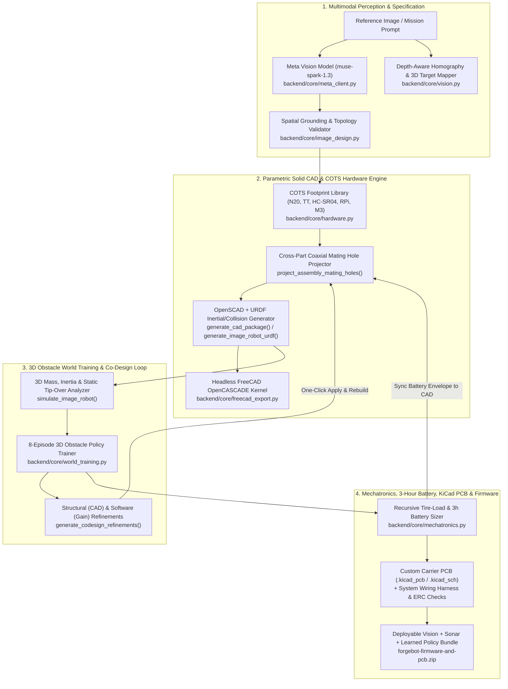
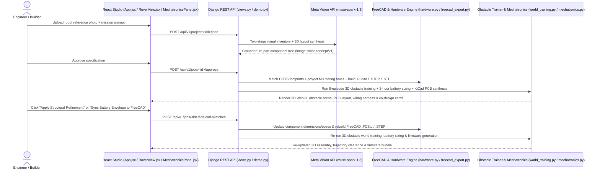

# ForgeBot: System Architecture, Engineering Milestones & Roadmap

> **Executive Pitch Summary**: ForgeBot is a closed-loop **Vision-to-Hardware-and-Firmware Co-Design Studio**. Given a single reference image or mission prompt, ForgeBot uses Meta's multimodal model (`muse-spark-1.3`) to propose a structured robot specification, compiles a manufacturable multi-body **FreeCAD** assembly (`.FCStd`, `.STEP`, `.STL`, `.URDF`) with aligned M3 fastener patterns, trains an obstacle-avoidance policy in a **3D WebGL Obstacle Arena**, sizes the **3-hour battery & powertrain** from tire load and turning scrub, synthesizes an inspectable **Custom Carrier PCB (`.kicad_pcb`) & System Wiring Harness**, and packages a **deployable Vision + Sonar + Learned Controller firmware bundle (`.zip`)**.

---

## 1. End-to-End System Architecture Diagram

---

## 2. Closed-Loop Co-Design Sequence Diagram

---

## 3. Completed Engineering Milestones

1. **Vision Depth & Spatial Generalization (`backend/core/vision.py`, `backend/core/meta_client.py`)**:
   - Height-aware planar homography (`project_pixel_at_height`) + two-view ray triangulation (`triangulate_two_view_ray_midpoint`).
   - Meta `muse-spark-1.3` two-stage visual inventory and 3D layout grounding with automatic transient error retry.
2. **Manufacturing-Ready CAD & COTS Hardware Detailing (`backend/core/hardware.py`, `backend/core/image_design.py`, `backend/core/freecad_export.py`)**:
   - Standard COTS footprint library (`N20`, `TT`, `HC-SR04`, `L298N`, `Raspberry Pi 4B`, `Arduino Uno`, `SG90/MG996R`, `3S LiPo`, `M3` standoffs, `65 mm` wheels).
   - Cross-part coaxial M3 mounting hole projection across mating plates and standoffs.
   - Multi-body solid booleans in FreeCAD (`.FCStd`, `.STEP`, `.STL`) + physics-ready `.URDF` with `<inertial>`, `<collision>`, and wheel `<joint type="revolute">`.
3. **3D Obstacle World Policy Training (`MuJoCo 3.17.0`) & Hardware/Software Co-Design (`backend/core/world_training.py`, `frontend/src/RoverView.jsx`)**:
   - Native **MuJoCo `3.17.0` (`MJCF`)** 3D rigid-body contact and sprung roll/pitch suspension simulation across 8 training episodes (`sim/forgebot_rover_mjcf.xml`).
   - Interactive Three.js 3D WebGL arena with 7 obstacles, spinning wheels, 3D sprung chassis roll/pitch dynamics, 3D routed electrical wiring harness (`⚡ 3D Wiring: ON/OFF`), ultrasonic cones, and Episode 1 (colliding) vs. Episode 4 (converged, 0 collisions) trajectory replay.
   - Automated Structural CAD Refinement cards (with one-click FreeCAD rebuild & re-simulation) + Learned Policy Gain table.
4. **Mechatronics, 3-Hour Battery Sizer, 3D FreeCAD Wire Harness, Inspectable KiCad PCB & Vision Firmware (`backend/core/mechatronics.py`, `frontend/src/MechatronicsPanel.jsx`)**:
   - Recursive tire-load & 3-hour battery endurance solver coupling CAD dry mass, tire rolling resistance, turning scrub, and `7.50 W` vision/avionics load.
   - **3D Routed Electrical Wire Harness (`parts/wiring_harness.stl`) & Detailed 3D PCB Solids** (XT60, 10A blade fuse, 5V 3A buck converter + toroidal inductor, 40-pin GPIO header, JST-XH headers, and raised copper power traces) built directly into `.FCStd`, `.STEP`, `.STL`, and the 3D WebGL viewers.
   - Interactive 2D Custom Carrier PCB inspector (`F.Cu`, `B.Cu`, `4× M3` standoff-aligned mounting holes) + native `.kicad_pcb` & `.kicad_sch` export + 5 automated `ERC/DRC` checks.
   - Downloadable firmware `.zip` (`hardware_pinout.py`, `vision_obstacle_detector.py`, `obstacle_avoidance_controller.py`, `run_robot.py --sim-self-test`, `pcb/forgebot_carrier.kicad_pcb`, `sim/forgebot_rover_mjcf.xml`).

---

## 4. Prioritized Future Roadmap (Where to Pick Up Next)

- **P1 — One-Click Gerber, Drill & JLCPCB Pick-and-Place (`CPL` / `BOM`) Export**: Add `kicad-cli` or native Gerber RS-274X + Excellon drill + JLCPCB centroid `.csv` generation so `forgebot_carrier.kicad_pcb` can be ordered with components pre-soldered.
- **P2 — Counterbores, Nut Traps & Heat-Set Insert Bosses in FreeCAD**: Extend `project_assembly_mating_holes` with 3D-printable M3 brass heat-set insert bosses and DIN 912 socket head counterbores.
- **P3 — ROS 2 (`humble`/`jazzy`) Launch & Navigation Package Export**: Bundle a complete `forgebot_bringup` ROS 2 package alongside the standalone Python runtime in `forgebot-firmware-and-pcb.zip`.

